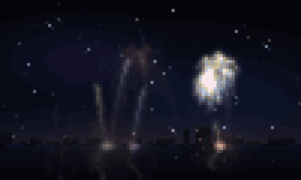
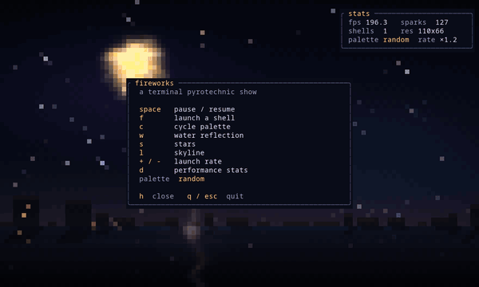

# fireworks

A pyrotechnic screensaver for your terminal. Rockets climb out of a distant
city, burst into peonies, willows, rings, palms and hearts, and the whole show
is mirrored in the water below.



Written in Rust with [ratatui](https://ratatui.rs) and crossterm. No external
assets, no network, no configuration required.

## Highlights

- **Nine shell styles** — peony, chrysanthemum, willow, ring, palm, crossette,
  strobe, heart and spiral, each with its own physics.
- **Real colour** — per-cell 24-bit colour, a persistence buffer for glowing
  comet trails, bloom, a filmic luminance tone curve and ordered dithering.
- **A scene, not just sprites** — gradient night sky, drifting nebula, twinkling
  stars, shooting stars, a lit city skyline and rippling water reflections.
- **Two sub-pixels per cell** — an upper-half block paints the top half of each
  cell with the foreground colour and the bottom half with the background, which
  doubles the vertical resolution and keeps sparks square.
- **Show dynamics** — random pacing, twin shells, and occasional multi-shell
  finales, so no two minutes look the same.
- **Spell a message** — `--text "HAPPY BIRTHDAY"` turns each word into a salvo
  of letter shells that write themselves across the sky.
- **Screensaver friendly** — `--any-key` quits on the first key press; `--seed`
  makes a show reproducible.

|                    | |
|--------------------|---|
| `space`            | pause / resume |
| `f`                | launch a shell |
| `c`                | cycle palette |
| `w`                | water reflection on/off |
| `s`                | stars on/off |
| `l`                | skyline on/off |
| `+` / `-`          | launch rate |
| `d`                | performance stats |
| `h`                | help |
| `q` / `esc`        | quit |

## Spell a message

```sh
cargo run --release -- --text "HAPPY BIRTHDAY"
```

Each word becomes its own salvo: one rocket per letter, launched left to right,
so the word writes itself across the sky before the next one goes up.

- Letters and digits use a 5x7 shell pattern (`A-Z`, `Ä Ö Ü`, `0-9`,
  `!?.,'-+=/: #*&<>()%` and `♥`); anything else falls back to `?`.
- `_` is a gap: it takes a letter's place in the line but fires no shell, so
  `HAPPY_BIRTHDAY` puts a space between the two halves without splitting them
  into separate salvos.
- Every word also gets a salvo of ordinary shells low in the sky as a backdrop.
- Long words wrap onto another line at the same letter size.
- `--text-speed` scales the whole pacing (2 = twice as fast, 0.5 = leisurely).
- The message loops forever, so it works as a party screensaver.


## Run it

```sh
cargo run --release
```

As a screensaver, exit on any key:

```sh
cargo run --release -- --any-key
```

## Options

```
--fps <FPS>          Target frame rate [default: 60, 30 over ssh]
--density <DENSITY>  Launch rate multiplier [default: 1]
--palette <NAME>     Colour palette (see --palettes) [default: random]
--seed <SEED>        Seed the show for a reproducible display
--text <TEXT>        Spell a message with letter shells, one word at a time
--text-speed <MULT>  Pace of --text (1.0 = default, 2.0 = twice as fast)
--any-key            Exit as soon as any key is pressed
--palettes           List the available palettes and exit
```

Palettes: `classic`, `ember`, `ocean`, `aurora`, `candy`, `neon`, `gold`,
`rainbow`, or `random` to pick per shell.



## How it works

The whole scene is simulated in floating point at sub-pixel resolution, then
quantised to terminal cells once per frame:

1. **Sparks** live in an additive buffer that is multiplied by a decay factor
   instead of being cleared, so every particle leaves a fading trail. Physics is
   plain semi-implicit Euler with per-particle gravity and drag.
2. **The grade** maps luminance through `1 - e^-x` and carries chroma along, so
   dense clusters of gold sparks stay gold instead of bleaching to white, then
   adds bloom, a vignette and 4×4 Bayer dither against banding.
3. **The terminal** gets one `▀` per cell: foreground is the top sub-pixel,
   background the bottom one.

Input is polled with a zero timeout and decoded locally rather than through a
blocking terminal read. A terminal (especially over SSH) may deliver an escape
sequence in several packets; a blocking read would freeze the show until the
next key, so partial sequences are buffered for the next frame and discarded
after a few milliseconds if they never complete.

## Development

```sh
cargo test        # simulation, palette and renderer checks
cargo clippy --all-targets -- -D warnings
```

The README GIFs are reproducible: `docs/make-gif.sh` renders them from seeded
sessions (it needs ImageMagick, ffmpeg, tmux and python3 with Pillow).

Handy hidden flags for poking at the look without a terminal:

```sh
# render a frame of a specific show to a PPM image
cargo run --release -- --screenshot out.ppm --warmup 6 --seed 12

# force every shell to one style (peony, ring, heart, ...)
cargo run --release -- --screenshot ring.ppm --kind ring --warmup 5
```

## License

MIT — see [LICENSE](LICENSE).
